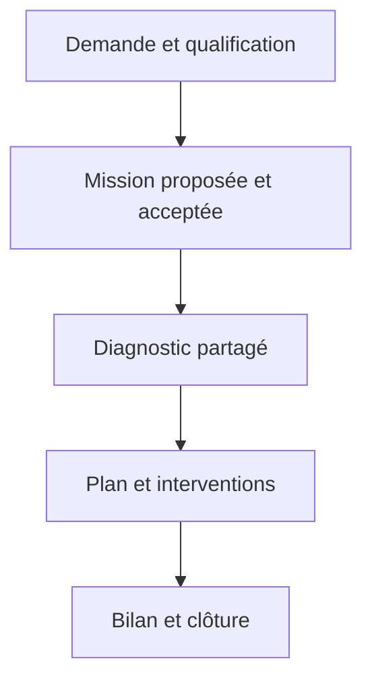

# DIGIT ABMEB — Cahier des charges du module 02

## Accompagnement des officines

**Version :** 1.0 — 10 novembre 2026  
**Destinataires :** direction métier, accompagnateurs, responsables d'officine, conception et développement  
**Statut :** proposition à valider — les parcours, formulaires et délais propres à l'entreprise sont proposés, car les pièces fournies décrivent surtout le fonctionnement de l'officine et non une méthode complète d'accompagnement.

## 1. Finalité et périmètre

Ce module organise le travail de l'entreprise qui accompagne les pharmacies : demande, qualification, mission, diagnostic, plan d'accompagnement, interventions, livrables, échanges et bilan. L'officine voit ce qui lui est partagé et participe aux décisions et aux actions selon ses droits. Chaque donnée appartient à une officine et à une mission identifiable ; son accès est contrôlé.

L'entreprise exploitante est distincte de l'ABMed. Un diagnostic ou un bilan interne n'est ni une inspection officielle ni une certification de conformité. Aucun échange avec le régulateur n'est automatisé ou présumé dans ce module.

**Inclus :** besoins, qualification, missions, objectifs, équipe, diagnostics, constats, visites et comptes rendus, suivi coordonné des actions, livrables, échanges limités au dossier et bilan. **Exclus :** devis, contrats, facturation et abonnement, gestion exhaustive des documents et modèles (module 3), moteur transversal des actions (module 4), auto-inspections (module 5), formations RH, stock et caisse. Les points d'intégration ci-dessous décrivent la coordination, pas une seconde implémentation.

## 2. Principes et dépendances

1. L'officine s'inscrit et est activée selon le module 1. Elle peut créer une demande ; une mission peut aussi être proposée par l'entreprise, avec validation métier du responsable officine avant lancement effectif, proposition à confirmer.
2. Chaque accompagnateur doit disposer de son affectation approuvée par l'officine conformément au module 1 ; affecter une personne à une mission ne contourne jamais cette approbation ni les permissions accordées.
3. Une officine peut avoir plusieurs missions et diagnostics successifs. Une mission peut être suspendue sans supprimer ses données ni les autres missions.
4. Une donnée est privée à l'entreprise tant qu'elle est marquée interne ; les éléments partagés sont visibles par les membres autorisés de l'officine. Les notes internes ne figurent ni dans les exports officine ni dans les API destinées à l'officine.
5. Les exigences réglementaires, barèmes, fréquences, SLA et méthodes non validés sont configurables ou laissés ouverts. Les indicateurs ne constituent pas une décision réglementaire.
6. Une action est stockée une seule fois dans le module 4 et liée à sa source ; un livrable versionné utilise le module 3. Si ces modules ne sont pas encore livrés, adopter une interface contractuelle unique et un stockage transitoire clairement migrable, sans recopies concurrentes.

## 3. Acteurs et permissions proposées

| Acteur | Consultation | Actions principales |
|---|---|---|
| Administrateur plateforme | Métadonnées nécessaires selon rôle ; pas d'accès automatique aux données métier sensibles | Paramétrage autorisé et audit. |
| Coordinateur | Portefeuille et missions auxquels il est autorisé | Qualifier, créer et piloter mission, proposer équipe, valider partage et bilan selon délégation. |
| Accompagnateur | Missions affectées, avec accès approuvé et actif | Préparer diagnostic, visites, constats et livrables selon permissions. |
| Pharmacien titulaire ou administrateur officine | Éléments partagés de son officine | Demander un accompagnement, accepter ou refuser mission et accès, commenter et valider selon rôle. |
| Responsable qualité / personnel | Éléments partagés et tâches autorisées | Répondre, fournir preuves et suivre actions selon rôles configurés. |
| Observateur | Éléments partagés limités | Lecture uniquement si autorisée. |

Permissions indépendantes par officine et par mission : `support.request.create/read/triage`, `mission.create/read/update/propose/accept/suspend/close`, `diagnostic.create/answer/submit/validate`, `finding.create/read`, `visit.plan/conduct/validate`, `deliverable.prepare/share/approve`, `comment.create`, `report.export` et `audit.read`. Catalogue à harmoniser avec le module 1. Aucun rôle ne permet l'auto-approbation réglementaire ou l'accès à une autre officine.

## 4. Parcours cible

La demande peut être refusée ou nécessiter des précisions ; la mission peut être suspendue, annulée ou clôturée. Les actions non terminées restent suivies même après un bilan, selon une décision explicite.

## 5. Navigation et vues

**Entreprise → Accompagnement :** tableau de bord, demandes, missions, calendrier, diagnostics, livrables, actions liées, rapports, référentiels autorisés. **Officine → Mon accompagnement :** demandes, missions partagées, diagnostics, planning, livrables, actions et échanges. Les listes disposent de recherche, tri, pagination, filtres, vues vides et messages d'erreur. Les dates sont présentées en heure de l'officine ; les timestamps sont enregistrés en UTC.

## 6. Tableau de bord et portefeuille

Liste de missions : référence, officine, intitulé, responsable, dates prévues, état, prochaine intervention, actions en retard et dernier événement partagé ; recherche par référence, nom et officine ; filtres état, responsable, période et commune. L'officine ne voit que ses missions autorisées. **Ouvrir** mène à la fiche. **Nouvelle mission**, **Exporter** et **Créer une demande** ne s'affichent et ne fonctionnent que selon permission.

Définitions : missions actives = missions `en_cours` autorisées ; demandes en attente = `soumise` ou `en_qualification` ; actions en retard = actions du module 4 non clôturées dont échéance est antérieure à la date locale courante ; visites à venir = visites confirmées et non annulées sur la période ; diagnostics validés = versions validées sur la période. Toujours afficher filtres, date de calcul et périmètre. Aucun taux de conformité global ne s'affiche sans méthode approuvée.

## 7. Demande et qualification

### 7.1 Création côté officine

**Demander un accompagnement** ouvre un formulaire : officine préremplie, demandeur et contact, thème(s) configurables, description du besoin, contexte, disponibilité souhaitée, degré d'urgence déclaré facultatif et pièces jointes facultatives. L'urgence est une déclaration et non une priorité automatiquement garantie. **Brouillon** sauvegarde une demande incomplète visible à ses auteurs autorisés. **Soumettre** contrôle description et contact, les droits et l'officine, crée une référence unique, passe à `soumise`, journalise et notifie l'équipe autorisée. Double clic/reprise réseau : une seule soumission via clé d'idempotence. **Annuler** demande confirmation si modifications non enregistrées ; **Retirer la demande** exige un motif et ne détruit pas son historique.

### 7.2 Traitement par votre entreprise

**Prendre en charge** assigne un coordinateur et passe à `en_qualification`. **Demander des précisions** ouvre objet, question, pièces attendues et date indicative facultative ; la demande passe à `precisions_demandees`, notifie l'officine et reste consultable. **Répondre** ajoute message et pièces, puis **Renvoyer** repasse à `soumise`. **Proposer une mission** crée un brouillon de mission lié, sans accès supplémentaire. **Refuser/terminer** demande un motif et choisit explicitement ce qui sera communiqué ; une copie du motif interne ne doit pas être exposée. **Archiver** retire de la liste active sans effacer.

États : `brouillon → soumise → en_qualification → precisions_demandees → soumise`, puis `convertie`, `refusee` ou `retiree`. Un dossier clôturé ne revient pas automatiquement à l'état soumis ; réouverture par action autorisée et traçable à valider.

## 8. Mission d'accompagnement

### 8.1 Création et proposition

**Nouvelle mission** ouvre : officine, référence générée, demande source facultative, intitulé, contexte, objectifs, périmètre inclus/exclu, responsable, dates prévisionnelles, lieu/mode, contacts et livrables prévus. Ne pas exposer les notes internes dans le descriptif partagé. La date de fin ne précède pas le début. **Enregistrer brouillon** conserve les données ; **Proposer à l'officine** vérifie les champs requis, fige une version de proposition et notifie les décideurs autorisés. Une mission n'ouvre aucun droit d'accès individuel.

### 8.2 Réponse de l'officine

Sur la fiche : **Accepter**, **Demander une modification**, **Refuser**. Accepter enregistre auteur, date et version acceptée ; demander une modification exige un commentaire et renvoie en préparation ; refuser demande un motif partageable. La proposition ne remplace pas un contrat ni une facture. Pour démarrer : mission acceptée, officine active et au moins un responsable disposant d'une affectation approuvée, active et compatible avec la portée. Toute proposition modifiée après acceptation est une nouvelle version à accepter si son périmètre ou ses conditions changent.

### 8.3 Fiche mission

En-tête : référence, officine, état, objectifs, responsable et dates. Onglets **Vue d'ensemble**, **Équipe**, **Diagnostic**, **Plan et actions**, **Visites**, **Livrables**, **Échanges**, **Historique**. Chaque onglet applique la portée et les droits ; un lien vers une ressource externe au module est résolu avec l'autorisation du module propriétaire.

### 8.4 États et transitions

| État | Transition / condition |
|---|---|
| `brouillon` | Création ou modification ; `proposee` après contrôles. |
| `proposee` | `acceptee`, `refusee` ou retour en préparation demandé par l'officine. |
| `acceptee` | `en_cours` après vérification des accès approuvés. |
| `en_cours` | `suspendue`, `bilan_en_preparation` ou `annulee` avec motif. |
| `suspendue` | `en_cours` après nouvelle vérification des accès ou `annulee`. |
| `bilan_en_preparation` | `cloturee` après les contrôles du §14, ou retour `en_cours`. |
| `cloturee`, `annulee`, `refusee` | Lecture et réouverture uniquement par procédure habilitée et tracée ; pas de suppression des preuves. |

**Suspendre** exige motif, date et commentaire partageable, et avertit des échéances ; les accès existants ne sont pas automatiquement prolongés. **Reprendre** contrôle le statut de l'officine et de chaque affectation. **Annuler** demande motif et confirme le traitement des visites et actions ouvertes ; n'efface rien.

## 9. Équipe de mission

**Ajouter un intervenant** sélectionne un collaborateur, fonction, dates et permissions demandées. L'interface indique `approbation requise` et renvoie vers le processus du module 1. Tant que l'approbation n'est pas accordée et active, la personne n'accède à aucune donnée. **Modifier la portée** crée une nouvelle demande d'approbation ; l'ancienne portée reste seule applicable tant qu'elle n'est pas révoquée. **Retirer** coupe les droits liés à l'affectation conformément au module 1, sans effacer les contributions passées. Les membres de l'officine participent sur la base de leurs propres droits, sans recevoir automatiquement les notes internes.

## 10. Diagnostic initial et diagnostics de suivi

### 10.1 Référentiel de diagnostic

Un modèle versionné comprend titre, objectif, version, sections, questions, libellés, consignes, types de réponse, choix, conditions, preuves attendues et statut de publication. Origines possibles : exigences et canevas extraits des documents fournis, complétés par une grille métier à valider. Les questions et barèmes détaillés ne sont pas inventés ici. Chaque exigence issue d'un texte externe doit pointer vers sa source, version et date de vérification ; les résultats ne prouvent pas à eux seuls la conformité légale.

### 10.2 Création et saisie

**Créer un diagnostic** : choisir mission, modèle publié et version, type initial/suivi, date et évaluateur. Le diagnostic fige la version du modèle. Pour chaque question : réponse structurée, commentaire, preuve, date et auteur ; réponses proposées configurables : conforme, écart, non applicable, non évalué, uniquement si le modèle les prévoit. `Non applicable` demande une justification ; `non évalué` reste distinct d'une réponse conforme. **Enregistrer brouillon** ne publie rien. **Joindre une preuve** utilise le stockage privé et vérifie la permission et le type/taille. **Créer un constat** ouvre un formulaire prérempli avec question et source, sans créer automatiquement une non-conformité.

**Soumettre** vérifie les questions obligatoires, motifs et droits, puis verrouille la version soumise ; **Demander correction** retourne une nouvelle révision en préparation avec commentaire ; **Valider et partager** fige auteur/date/version et rend visible à l'officine, en excluant les notes internes. Les modifications ultérieures produisent une nouvelle version. Un diagnostic initial peut être comparé à un diagnostic de suivi sur les questions de même identifiant et version compatible ; les questions modifiées sont signalées, sans inventer une comparaison équivalente.

### 10.3 Formulaire d'un constat

Champs : officine, mission, diagnostic/question d'origine, titre, description factuelle, catégorie proposée (point fort, point à améliorer, écart, non-conformité potentielle), niveau de priorité interne optionnel, cause présumée séparée du fait, recommandation, preuve, auteur, date, visibilité et statut. Les catégories d'auto-inspection observées dans les pièces sont une source utile ; leur application au diagnostic d'accompagnement est une proposition. **Partager** rend le constat visible à l'officine ; **Créer action** appelle le module 4 avec source et préremplissage. **Qualifier en non-conformité** nécessite un acteur autorisé et le module 6 ; ne pas requalifier automatiquement.

## 11. Plan d'accompagnement et actions

Plan : référence, mission, version, objectifs, période, statut, éléments et date d'approbation. Ligne : source (constat ou besoin), résultat attendu, action liée, responsable, personnes impliquées, échéance, priorité configurable, preuve attendue et commentaire. **Ajouter une action** ouvre le module 4 ; le module 2 conserve une référence, pas une copie indépendante. Plusieurs sources peuvent être liées si leur périmètre est identique ; prévenir les doublons sans les fusionner automatiquement.

**Soumettre le plan** vérifie responsables et dates obligatoires ; **Approuver** exige un responsable officine habilité et fige la version ; **Demander modification** préserve l'historique. L'ajout ou le report important après approbation crée une révision soumise à validation selon la politique définie. Le responsable suit brouillon, à faire, en cours, terminé, vérification d'efficacité et clôture via les états effectifs du module 4. Une tâche réalisée n'est pas automatiquement efficace ou clôturée. Un retard est calculé et ne change pas à lui seul l'état.

## 12. Visites et interventions

### 12.1 Planification

**Planifier une intervention** : mission, type (visite, réunion, formation ou suivi ; liste configurable), objet, mode présentiel/distance, lieu ou lien privé, date/heure début et fin avec fuseau, participants, responsable, objectifs et pièces préparatoires. Contrôles : fin après début, mission éligible, intervenant autorisé. Détection de conflit de calendrier informative ; ne pas bloquer sans règle validée. **Enregistrer brouillon**, **Proposer** et **Confirmer** : notification aux participants, confirmation selon rôle désigné par l'officine. **Reporter** exige motif, nouvelle date et historique ; **Annuler** exige motif et notifie. Les dates et participants passés restent traçables.

États : `brouillon`, `proposee`, `confirmee`, `realisee`, `reportee`, `annulee` ; un report peut créer une nouvelle occurrence reliée à l'ancienne pour préserver l'historique. La tenue réelle est enregistrée séparément des dates prévues.

### 12.2 Compte rendu

**Rédiger le compte rendu** ouvre : intervention, dates réelles, participants présents/absents, objectifs, activités réalisées, constats, décisions, actions liées, pièces et prochaine étape ; sections internes séparées des sections partagées. **Sauvegarder brouillon**, **Soumettre**, **Demander correction**, **Valider et partager**. La version validée et la date de partage sont immuables ; correction ultérieure par nouvelle version. L'officine peut commenter ou accuser réception si son rôle l'autorise ; un accusé n'est pas une signature juridique présumée. Les formations détaillées relèvent du module personnel/formation, reliées à l'intervention.

## 13. Livrables, preuves et échanges

Livrable : type configurable, titre, mission, origine, auteur, version, statut, échéance, fichier/contenu, destinataires, visibilité et décision. **Ajouter** importe une pièce ou crée une référence vers un document du module 3 ; contrôles de type, taille, intégrité et accès privé. **Soumettre pour revue** fige une version ; **Demander correction** documente les remarques ; **Partager** publie la version validée aux destinataires ; **Approuver/refuser** par le rôle habilité enregistre décision et commentaire ; **Télécharger** vérifie le droit au moment du téléchargement. États proposés : brouillon, en_revue, corrections_demandees, partage, accepte, refuse, remplace. Une version remplacée reste accessible selon droits ; aucune écriture silencieuse sur une version validée.

Échanges : fil rattaché à la mission, commentaires datés avec auteur, pièces et visibilité `interne` ou `partagee`. Publier un commentaire partagé notifie uniquement les personnes autorisées ; vérifier la visibilité avant envoi. Modifier ou retirer un commentaire partagé suit une politique à définir et conserve une trace ; ne pas permettre à une mention de créer un accès. Ce fil n'est pas un canal d'urgence ni une transmission à l'ABMed.

## 14. Bilan et clôture

**Préparer le bilan** préremplit une synthèse : objectifs, période effective, interventions réalisées, diagnostics et constats, livrables partagés, actions par état, difficultés et recommandations. L'auteur vérifie chaque élément et distingue actions terminées de celles dont l'efficacité est démontrée. Formulaire : synthèse, résultats, actions en cours et responsables, éléments non réalisés, recommandations, prochaine étape et pièces.

**Soumettre** fige la version ; **Demander correction** ouvre une révision ; **Partager** informe l'officine ; **Accuser réception/valider** dépend du rôle et de la politique métier. **Clôturer** exige une mission en bilan, un bilan partagé et une décision explicite sur les actions ouvertes (transférer à un responsable/mission, conserver au suivi ou justifier) ; il ne faut ni les supprimer ni les marquer réalisées. Enregistrer décision, auteur, date et motif ; prévenir les intervenants. La clôture d'une mission ne révoque pas automatiquement une affectation générale : sa fin est pilotée par le module 1 et sa portée.

## 15. Statistiques et notifications

| Événement | Destinataires autorisés | Déclenchement |
|---|---|---|
| Nouvelle demande ou précisions | Coordinateurs ou demandeur | Après transaction et selon visibilité. |
| Proposition, acceptation ou refus de mission | Officine et responsable | Après décision, avec lien privé. |
| Demande d'accès intervenant | Administrateurs officine | Module 1, avant accès. |
| Visite proposée, confirmée, reportée ou annulée | Participants autorisés | Après changement ; pas de divulgation du lien privé à des tiers. |
| Diagnostic, plan, compte rendu, livrable ou bilan partagé | Destinataires autorisés | Après publication effective. |
| Échéance d'action / retard | Responsable et profils configurés | Source module 4 ; éviter les rappels en double. |

Utiliser une outbox, des clés d'idempotence, des tentatives d'envoi tracées et des préférences autorisées. Une erreur d'email ne doit pas annuler silencieusement l'enregistrement métier ; afficher l'état de livraison à un acteur habilité.

## 16. Modèle de données proposé

UUID, `pharmacy_id` sur chaque agrégat métier et clés étrangères vérifiant l'appartenance ; dates métier avec fuseau et timestamps UTC. Les tables `users`, `pharmacies`, `support_requests`/affectations du module 1 restent les sources de vérité pour les personnes et accès. La « demande d'accompagnement » ci-dessous se nomme `service_requests` pour éviter toute collision avec les demandes d'accès `support_requests` du module 1.

| Entité | Champs principaux / contraintes |
|---|---|
| `service_requests` | id, pharmacy_id, auteur, contact, description, urgence déclarée, statut, version, submitted_at. |
| `service_request_messages` | demande, auteur, visibilité, texte, pièce, created_at. |
| `missions` | id, pharmacy_id, request_id nullable, référence unique par officine, titre, objectifs, dates prévues/réelles, responsable, statut, version. |
| `mission_versions` | mission_id, numéro, portée et objectifs figés, proposition, décision, auteur et dates. |
| `mission_participants` | mission, user, fonction, période, référence à l'affectation approuvée du module 1 ; pas de droit d'accès autonome. |
| `diagnostic_templates`, `diagnostic_template_versions`, `diagnostic_questions` | modèle, version publiée, sections, identifiants stables des questions, types, règles et références ; version figée. |
| `diagnostics`, `diagnostic_responses` | mission, modèle versionné, type, état, version, réponses typées, justification, auteur et dates. |
| `findings`, `finding_sources` | mission, diagnostic/question, faits, classification, recommandation, priorité, visibilité, état, preuves. |
| `support_plans`, `support_plan_versions`, `support_plan_action_links` | mission, état, version approuvée, objectifs et liens vers actions du module 4. |
| `visits`, `visit_participants`, `visit_reports`, `visit_report_versions` | planification, états, participants, réalisation et rapports versionnés. |
| `mission_deliverables`, `deliverable_versions` | mission, type, état, versions, référence au document du module 3, visibilité et décisions. |
| `mission_comments`, `attachments` | auteur, visibilité, lien vers fichier privé, date ; filtrage strict des notes internes. |
| `mission_closures`, `decision_events` | bilan, décision sur actions ouvertes, acteur, date, version et motif. |
| `audit_events`, `notification_outbox` | Réutiliser les services transversaux du module 1, pas de copie métier. |

Unicité des références et versions, intégrité croisée tenant/mission, contrôle des transitions, verrouillage optimiste et journalisation. Ne pas référencer une preuve ou une action d'une autre officine. Conservation et suppression selon politique à définir ; pas de suppression en cascade des preuves.

## 17. API indicative et règles techniques

| Endpoint | Opération |
|---|---|
| `POST /pharmacies/{id}/service-requests` ; `POST /service-requests/{id}/submit` | Créer puis soumettre. |
| `POST /service-requests/{id}/clarifications` ; `/respond` | Demander et transmettre précisions. |
| `GET/POST /pharmacies/{id}/missions` ; `GET/PATCH /missions/{id}` | Liste et fiche selon portée. |
| `POST /missions/{id}/propose` ; `/decision` ; `/start` ; `/suspend` ; `/close` | Transitions contrôlées, version de concurrence et idempotence. |
| `POST /missions/{id}/diagnostics` ; `PATCH /diagnostics/{id}/responses` ; `POST /diagnostics/{id}/submit` ; `/share` | Diagnostic versionné et publication. |
| `POST /diagnostics/{id}/findings` ; `POST /findings/{id}/action-links` | Constats et création/lien d'action via module 4. |
| `POST /missions/{id}/plans` ; `POST /support-plans/{id}/decision` | Plan et approbation. |
| `POST /missions/{id}/visits` ; `POST /visits/{id}/reschedule` ; `/cancel` ; `/reports` | Visites et rapports. |
| `POST /missions/{id}/deliverables` ; `POST /deliverables/{id}/share` | Livrables versionnés via module 3. |
| `GET/POST /missions/{id}/comments` ; `GET /missions/{id}/export` | Fil et export filtrés selon visibilité. |

Chaque requête vérifie authentification, état de l'officine, autorisation effective et affectation approuvée active, portée de mission, visibilité et transition. Codes 400 validation, 401 authentification, 403 accès refusé, 404 ressource non accessible, 409 état ou version périmée, 429 limitation. Les contenus internes ne figurent ni dans les métadonnées, agrégats, recherches, URLs ou exports de l'officine.

## 18. Recette

1. L'officine active crée une demande, reçoit une demande de précision, répond puis voit la mission proposée et acceptée.
2. Une proposition refusée ou non acceptée ne démarre pas ; une double décision concurrente ne crée pas deux missions actives.
3. Un accompagnateur proposé, refusé, expiré ou retiré ne peut lire ni modifier la mission, y compris par API directe ; modification de portée exige réapprobation.
4. Un diagnostic conserve sa version de modèle ; `non évalué` ne compte pas comme conforme ; les questions modifiées ne sont pas faussement comparées.
5. Un constat crée une seule action via le module 4 et le lien est visible des deux côtés ; absence du module est signalée sans créer de doublons.
6. Le plan soumis peut être approuvé ou retourné, et une version approuvée reste reconstructible après révision.
7. Une visite reportée conserve son ancien horaire, notifie les autorisés et ne crée pas deux visites réalisées.
8. Une pièce ou note interne n'apparaît ni dans l'interface officine, ni dans l'export, la recherche, les notifications ou un lien direct non autorisé.
9. Un livrable validé corrigé produit une nouvelle version, sans écraser l'ancienne.
10. Une mission ne se clôture pas sans bilan partagé et décision sur les actions ouvertes ; ces actions restent suivables.
11. Les statistiques respectent états, périodes et droits ; une panne d'email n'affiche pas un envoi réussi.
12. Requêtes directes, fichiers et exports entre deux officines sont refusés ; toutes les décisions sont journalisées sans secrets.

## 19. Questions métier à trancher

- Quels types exacts de prestations, étapes, livrables, niveaux de priorité et délais pratique votre entreprise ?
- L'acceptation d'une mission ou d'un plan suffit-elle avec un administrateur officine, ou faut-il le pharmacien titulaire nommément ?
- Quelle grille de diagnostic validée, quelles sources, quels barèmes et quelles règles de calcul doivent être utilisés ?
- Quelle visibilité et quels délais de conservation pour les notes internes, preuves, comptes rendus et historiques ?
- Le partage et l'accusé de réception sont-ils suffisants ou une signature répondant à des exigences particulières est-elle nécessaire ?
- Comment gérer missions parallèles, renouvellement, changements contractuels et abonnements ? Ces sujets nécessitent le module SaaS/commercial futur.

## 20. Livrables attendus du développement

Écrans entreprise et officine, règles de visibilité, workflow et historique, diagnostics versionnés, coordination des actions, interventions, livrables et bilan ; API et migrations ; notifications et journal ; tests d'autorisation, concurrence, version et isolation ; documentation d'exploitation et migration des interfaces provisoires vers les modules 3 et 4.
