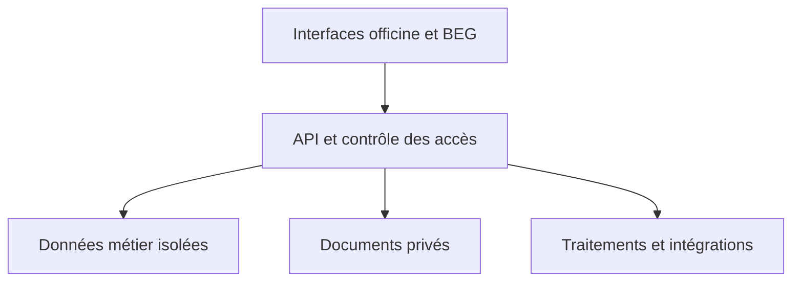

# BEGPHARMA — Cahier des charges général et socle du projet

**Version :** 0.2 — 10 novembre 2026  
**Statut :** document de cadrage révisé à valider  
**Destinataires :** direction BEG, responsables métier, pharmaciens référents, équipe produit, conception, développement et recette.

Ce document fixe la vision et les règles communes du projet. Il sert de référence pour rédiger les cahiers des charges détaillés, module par module. Il ne remplace ni les textes applicables, ni l'approbation des autorités, ni la validation métier, juridique et comptable nécessaire avant mise en production.

## 1. Origines et statut des informations

Sources de travail : le document fourni « Cahier des charges BEGPHARMA(1).docx » ; l'archive « 0000. DIGIT ABMEB.zip » et les cahiers modules 01 et 02 préparés pendant les échanges. Le nom BEGPHARMA est retenu pour le produit dans ce document ; DIGIT ABMEB désigne le chantier documentaire présenté dans les échanges, sous réserve de décision définitive sur le nom commercial.

Les éléments sont distingués ainsi : **[D]** décision exprimée par le commanditaire ; **[S]** contenu ou objectif du document source à confirmer ; **[P]** proposition de conception ; **[V]** point nécessitant validation avant réalisation ou mise en service. Le document source comporte un inventaire annoncé de 59 modèles et une grille annoncée de 267 articles ; leur exhaustivité et leur correspondance exacte avec les fichiers disponibles doivent être vérifiées, et ne sont pas attestées par ce cahier.

## 2. Vision et objectifs

BEGPHARMA est une plateforme SaaS tout-en-un destinée aux officines, permettant de gérer leurs opérations et leur système qualité et à BEG de les accompagner. L'objectif est de réduire la paperasse et la ressaisie, de faciliter le pilotage quotidien, de conserver des preuves et de suivre les actions dans le temps.

L'officine reste responsable de ses activités et décisions professionnelles. BEG accompagne et fournit le service ; l'ABMed est distincte de BEG. L'activation d'un compte, un score ou une exportation de BEGPHARMA ne constituent pas une autorisation d'exercice, une validation officielle ou une certification. Aucun portail, accès ou transmission automatique à l'ABMed n'est présumé.

Objectifs : (1) un espace par officine avec isolation stricte ; (2) saisie structurée et réutilisation autorisée ; (3) documents et enregistrements traçables ; (4) suivi d'accompagnement, des risques et actions ; (5) gestion pharmaceutique et commerciale par phases ; (6) pilotage à distance par profil ; (7) continuité d'activité adaptée aux coupures ; (8) extension vers comptabilité, trésorerie, paie et déclarations après validation de leurs règles.

## 3. Décisions confirmées, hypothèses et arbitrages

| Réf. | Sujet | État | Position |
|---|---|---|---|
| DEC-01 | Modèle | D | SaaS multi-officines ; chaque pharmacie dispose de son propre espace. |
| DEC-02 | Création | D | L'officine s'inscrit ; l'administration du SaaS instruit et valide la demande. |
| DEC-03 | Accompagnateur | D | Chaque accès d'accompagnement est soumis à l'approbation de l'officine. |
| DEC-04 | Rôles | D | Chaque officine peut créer ses rôles ; l'ajout d'un membre propose plusieurs rôles par cases à cocher. |
| DEC-05 | Administrateurs | D | Plusieurs administrateurs de l'officine sont possibles. |
| DEC-06 | Connexion | D/V | Email et Google ; architecture extensible à d'autres fournisseurs encore à choisir. |
| DEC-07 | Supports | D | Les canevas vierges sont implémentés ; les supports remplis servent aussi à reconstruire les modèles. |
| DEC-08 | Documents d'inscription | V | Liste des pièces et obligations de contrôle non arrêtées. |
| DEC-09 | Paiement | S/V | FeexPay est prévu dans le document initial ; contrat, choix final et interfaces restent à confirmer. |
| DEC-10 | Produit | S/V | PWA, API REST et base relationnelle partagée sont proposées ; technologie et hébergement restent à décider. |
| DEC-11 | BPD | S/V | Dix chapitres et couverture visée dans le document source ; source normative, articles, version et interprétations à vérifier. |
| DEC-12 | Continuité | S/V | Mode hors ligne visé pour caisse, dispensation, pointage et températures ; faisabilité et limites à décider fonction par fonction. |
| DEC-13 | Calendrier | S/V | Durées du document initial indicatives, à réestimer après cadrage et preuves de faisabilité. |

## 4. Parties prenantes et responsabilités

| Acteur | Responsabilité et limite |
|---|---|
| Promoteur / propriétaire | Pilote les indicateurs financiers et opérationnels autorisés ; accès clinique nominatif restreint, non implicite. |
| Pharmacien titulaire | Responsabilités pharmaceutiques, validation métier et administration de l'officine selon autorisations définies. |
| Pharmacien adjoint, assistant ou remplaçant | Accès et actes relevant de son habilitation et du cadre validé. |
| Responsable management qualité | Documents, contrôles, constats et suivi des actions selon rôle accordé. |
| Personnel | Utilise les fonctions nécessaires : dispensation, stock, caisse, entretien ou autres selon poste et rôle. |
| Comptable / expert-comptable | Fonctions comptables, fiscales et paie expressément autorisées ; pas d'accès clinique par défaut. |
| Administrateur SaaS BEG | Gestion des inscriptions, paramètres et exploitation ; pas d'accès automatique au contenu métier sensible. |
| Coordinateur et accompagnateur BEG | Missions confiées et accès approuvés par officine ; permissions limitées dans le temps et au périmètre. |
| Inspecteur ou observateur autorisé | Éventuel accès temporaire en lecture seule accordé par l'officine ; ne suppose aucune intégration officielle. |

Le poste RH, la qualification professionnelle et les permissions applicatives sont trois notions distinctes. Les rôles personnalisés ne peuvent pas lever une restriction de sécurité ou une habilitation réservée à un acteur qualifié.

## 5. Périmètre fonctionnel de référence

| Domaine | Fonctions principales | Dépendances |
|---|---|---|
| Socle SaaS | Inscription, validation, espaces, authentification, rôles et permissions, abonnements à définir, journal | Identité, isolation des données |
| Accompagnement BEG | Demandes, missions, diagnostics, équipe approuvée, visites, livrables, bilan | Socle, documents, actions |
| Qualité BPD | SMQ, auto-évaluation, documents, registres, risques, CAPA, auto-inspections, revue | Référentiels, versions, rôles |
| Personnel | Dossiers, postes, habilitations, formations, absences, planning, gardes, pointage | Identité, confidentialité |
| Locaux et équipements | Inventaire, mise en service, maintenance, étalonnage, températures, nettoyage | Équipements, actions, preuves |
| Produits et achats | Catalogue, fournisseurs, commandes, réceptions, contrôle, retours | Référentiel produits, fournisseurs |
| Stock | Lots, péremption, quarantaine, FEFO, mouvements et inventaires | Catalogue et réceptions |
| Dispensation et vigilance | Ordonnances, analyse et conseils, registres, signalements, rappels | Personnes habilitées, lots, données privées |
| Ventes et caisse | Panier, règlement, sessions, passations, rapprochements, avoirs | Stock, paiement, règles de facturation |
| Comptabilité et trésorerie | Journaux, écritures, rapprochements, états et préparations fiscales | Transactions validées, plan comptable |
| Paie et déclarations | Variables, calculs, bulletins, écritures et états préparatoires | RH, pointage validé, barèmes datés |
| Pilotage | Indicateurs, alertes, exports, lecture contrôlée pour inspection | Définitions et permissions de chaque module |

Commerce électronique au public, livraison, application patient et fabrication de préparations magistrales : considérés comme extensions à décider dans le document initial ; aucun engagement de livraison ni présomption d'autorisation. Le périmètre exact du registre des préparations est à confirmer. Une consolidation multi-officines pour un promoteur peut être étudiée indépendamment du socle SaaS multi-tenant déjà décidé.

## 6. Guide BPD et traçabilité métier

Le document initial structure la phase qualité autour de dix chapitres : système qualité ; personnel ; documentation ; locaux et système informatisé ; approvisionnement et stockage ; sous-traitance ; dispensation et vigilances ; retours et rappels ; déchets ; auto-inspection. Cette structure doit être conservée pour la traçabilité, tout en proposant une navigation métier simple.

La matrice source du cahier initial regroupe des plages d'articles et prévoit sa déclinaison article par article. Avant de prétendre à une couverture complète, établir pour chaque disposition : identifiant, texte et version de référence, applicabilité, interprétation validée, fonctionnalité, modèle, preuve, responsable, test, état et date de revue. Identifier explicitement les lacunes, articles non applicables et éléments non évalués. Toute grille ou score est versionné ; son barème, ses pondérations et son traitement des réponses non applicables doivent être approuvés avant calcul. Le score est un indicateur interne et ne doit pas être présenté comme une certification.

Le document source mentionne des exigences, durées de conservation et démarches de validation du logiciel. Leur exactitude, actualité, champ et modalités restent à vérifier sur les textes et auprès des interlocuteurs compétents. Ne pas coder une obligation comme certaine ni afficher « conforme » sur cette seule base.

## 7. Parcours de bout en bout

### 7.1 Entrée d'une officine

1. Le demandeur crée un compte par email ou Google et vérifie son identité numérique selon le mécanisme choisi.
2. Il renseigne la pharmacie et enregistre un brouillon ou soumet son dossier ; la liste des justificatifs est à décider.
3. BEG examine la demande, peut demander des corrections, approuver ou refuser avec motif et trace. Une approbation est distincte d'une licence sanitaire.
4. Après activation, l'administrateur officine complète le profil, invite les membres et attribue un ou plusieurs rôles par cases à cocher.
5. Il configure ses paramètres autorisés, documents, référentiels et modules activés ; les données des autres officines restent invisibles.

### 7.2 Accompagnement

L'officine ou BEG initie une demande. BEG propose une mission et une équipe ; l'officine approuve les accès individuels des accompagnateurs. L'équipe réalise le diagnostic, partage les constats, propose un plan, organise des visites et suit les livrables. Les décisions de validation, de suspension et de clôture, les notes internes et les éléments partagés sont tracés séparément. Le processus détaillé d'accompagnement est une proposition à confirmer par BEG.

### 7.3 Activité de l'officine

Les équipes réalisent leurs tâches avec les droits appropriés : réception, mouvements de stock, dispensation, caisse, entretien et documentation. Les opérations structurées alimentent les registres et rapports liés sans double écriture manuelle lorsque les règles sont validées. Toute correction d'une opération validée suit une procédure de rectification ou de contrepassation adaptée, et non un écrasement silencieux.

### 7.4 Contrôle et amélioration

Une inspection, réclamation, anomalie, température ou analyse de risque peut produire un constat. Un acteur habilité le qualifie ; des actions, responsables, échéances et preuves sont définis. La réalisation est distincte de la vérification d'efficacité. La clôture est motivée et historisée ; l'action reste liée à sa source, visible depuis chaque contexte autorisé.

## 8. Exigences fonctionnelles transversales

### 8.1 Accès et sécurité

- **SOC-01 [D]** : inscription autonome, examen administratif et activation contrôlée ; un compte en attente n'accède pas à l'espace métier actif.
- **SOC-02 [D]** : chaque officine gère ses rôles personnalisés et peut en affecter plusieurs ; séparation des rôles par officine et protection du dernier administrateur actif.
- **SOC-03 [D]** : l'affectation d'un accompagnateur BEG n'accorde l'accès qu'après approbation de l'officine ; changement de portée et révocation sont tracés.
- **SOC-04 [P]** : contrôle côté serveur sur toute lecture, écriture, recherche, export, fichier et tâche asynchrone ; isolation stricte par officine y compris sur requête directe.
- **SOC-05 [S/V]** : authentification renforcée pour comptes sensibles proposée ; déterminer profils concernés, mécanismes et récupération.
- **SOC-06 [P]** : support BEG à accès temporaire, limité, approuvé et journalisé ; procédure d'urgence et durée à valider.

### 8.2 Documents et canevas

- **DOC-01** : distinguer modèle vierge, document adapté à une officine et enregistrement rempli. Chaque enregistrement référence la version utilisée.
- **DOC-02** : inventaire configurable par officine : type, processus, code, titre, version, auteur, approbateur, statut, date et destinataires.
- **DOC-03** : cycle proposé brouillon → vérification → approbation → diffusion → remplacement/archivage ; droits et exceptions à valider. Une version publiée n'est pas écrasée.
- **DOC-04** : attestation de lecture par destinataire sur version exacte ; différencier lecture déclarée, compréhension et signature à valeur juridique.
- **DOC-05** : champs typés, tableaux répétables, calculs, pièces, contrôles, modèles de rendu et exports soumis aux permissions.
- **DOC-06** : inventorier toutes les sources, distinguer modèles, exemples remplis et pièces manquantes ; aucune donnée nominative d'une officine ne devient donnée générique d'une autre.
- **DOC-07** : conservation et archivage paramétrables après validation des catégories et durées applicables ; pas de suppression automatique non approuvée.

### 8.3 Actions, constats et qualité

- Un constat peut être issu d'une mission, d'une inspection, d'un incident ou d'une réclamation. Sa qualification et sa visibilité sont contrôlées.
- Un plan comporte des actions liées à leur source, un responsable, une échéance, des preuves et des critères de suivi. Une action n'est pas dupliquée dans chaque module source.
- Les statuts, reports et décisions sont historisés. Retard = échéance dépassée pour une action non clôturée ; l'absence d'efficacité démontrée ne devient pas une clôture implicite.
- Les échelles de risque de 1 à 4 et les calculs criticité = probabilité × gravité et priorité = probabilité × pertinence figurent dans les modèles étudiés ; portée et seuils d'interprétation à valider.

### 8.4 Données de santé et informations sensibles

Collecter seulement les informations nécessaires à une finalité documentée. L'accès nominatif aux données cliniques est limité aux professionnels et personnes expressément habilités selon règles validées ; le caissier, le magasinier, le comptable, le promoteur et l'accompagnateur n'y ont pas accès par défaut. Le promoteur reçoit des indicateurs agrégés autorisés ; la matrice initiale doit être ajustée pour lever l'ambiguïté entre lecture du domaine et accès nominatif.

Séparer dossier pharmaceutique, historique, consentements et registres selon une analyse métier et juridique validée ; ne pas présumer qu'une même base légale ou durée de conservation couvre tous les traitements. Chiffrer, tracer les accès sensibles, limiter les exports et tester la restauration. Les droits des personnes et exceptions de conservation doivent faire l'objet d'une procédure validée.

## 9. Architecture et frontières du système

### 9.1 Proposition d'ensemble

Application web responsive avec expérience PWA à évaluer sur les appareils cibles ; API sécurisée ; base relationnelle ; stockage objet privé ; traitements asynchrones pour notifications et exports ; supervision et sauvegardes. La pile, le lieu d'hébergement, le fournisseur d'identité et les technologies de file restent des décisions de phase 0.

Les permissions d'une requête dépendent de l'utilisateur, de l'officine, du rôle, de l'état du compte, de la ressource et, pour un accompagnateur, de l'affectation approuvée et valide. Les modèles généraux, référentiels partagés et données strictement privées sont distingués explicitement. Tester les accès croisés sur toutes les surfaces, y compris fichiers, recherches, rapports et tâches.

### 9.2 Données et transactions

Entités conceptuelles : organisations, officines, comptes, appartenances et rôles ; missions ; modèles et documents versionnés ; registres et preuves ; personnes et postes ; équipements ; produits, lots, commandes et mouvements ; dispensation, ventes, paiements et sessions de caisse ; constats et actions ; écritures comptables ; événements d'audit. La structure physique et les relations seront spécifiées dans les cahiers techniques.

Les opérations sensibles nécessitent contraintes d'intégrité, contrôle de concurrence, idempotence, transactions et événements traçables. Les mouvements de stock et écritures validées sont rectifiés par une opération opposée ou corrective autorisée, selon règles métier. Les notifications externes partent après l'enregistrement durable, avec suivi d'échec et tentatives contrôlées.

### 9.3 Mode hors ligne

Le document initial souhaite rendre disponibles hors ligne la caisse, la dispensation, le pointage et les températures. Décider séparément ce qui est faisable et autorisé : données minimales téléchargées, appareils approuvés, sécurité du stockage, durée, authentification, opérations permises, retrait d'un accès, comportement en cas de rappel de lot et interruption prolongée.

Conserver l'heure de l'appareil, le fuseau, la date de synchronisation et, après réception, l'heure serveur. Signaler les dérives et ne pas présenter une heure locale comme une preuve serveur. Définir des règles par opération pour stocks simultanés, produit rappelé, paiement à statut inconnu, doublon et résolution des conflits. Prévoir des procédures manuelles vérifiées lorsqu'une opération ne peut être effectuée de façon sûre hors ligne. Valider ces scénarios avant tout engagement de mise en production.

## 10. Intégrations

| Intégration | Fonction envisagée | État et prérequis |
|---|---|---|
| Email et Google | Connexion et communications | Décision de principe ; configuration et sécurité à définir. |
| Autres fournisseurs de connexion | Méthodes additionnelles | Non sélectionnés ; aucune disponibilité présumée. |
| FeexPay | Paiement mobile et autres moyens offerts | Prévu par le document source ; contrat, API, sécurité, opérateurs, remboursement et rapprochement à confirmer. |
| Facturation normalisée DGI | Reçu ou dispositif fiscal pertinent | Modalités et procédures techniques à vérifier ; aucun raccordement présumé. |
| Banque de données médicaments | Informations de référence | Fournisseur, licence, mises à jour, couverture et sécurité d'usage à choisir. |
| Logiciel comptable BEGSUITE COMPTA | Réutilisation ou connexion | Décision entre intégration et module natif à prendre ; définir source de vérité. |
| Capteurs | Remontée de températures | Modèles, protocole, fiabilité et résolution des pannes à valider. |
| ABMed et organismes | Notifications, formulaires ou échanges | Identifier les canaux officiels et les autorisations ; un enregistrement interne ne vaut pas transmission officielle. |

Tout connecteur documente fournisseur, authentification, données, droits, statut, tentatives, erreurs, rapprochement, contrats, reprise et preuve de réception. Un paiement n'est confirmé qu'après vérification du statut par un canal fiable ; les messages rejoués ne doivent pas générer plusieurs transactions.

## 11. Exigences non fonctionnelles et cibles proposées

Ces cibles sont reprises ou adaptées du document initial et restent à mesurer et contractualiser, non des performances garanties.

| Réf. | Domaine | Cible proposée / condition de mesure |
|---|---|---|
| NF-01 | Recherche | < 500 ms sur 20 000 produits dans conditions de test à définir, avec percentile et appareil précisés. |
| NF-02 | Vente | < 2 s pour validation interne hors paiement externe, conditions de charge à définir. |
| NF-03 | Disponibilité | 99,5 % par mois hors maintenance annoncée, méthode et périmètre à contractualiser. |
| NF-04 | Sauvegarde | Quotidienne, copie séparée, exercice trimestriel ; RPO cible 24 h et RTO à définir puis tester. |
| NF-05 | Protection | Chiffrement en transit et au repos, contrôle des accès, secrets sécurisés, protection contre abus. |
| NF-06 | Traçabilité | Journal append-only protégé et contrôles d'intégrité pour événements sensibles ; définir rétention et accès. |
| NF-07 | Ergonomie | Français, mobile et poste comptoir ; tests avec utilisateurs réels, clavier et lecteur. |
| NF-08 | Formats | Fuseau Africa/Porto-Novo, affichage dates JJ/MM/AAAA, monnaie XOF ; précision des montants et règles d'arrondi à valider. |
| NF-09 | Restauration | Tester restauration de données et pièces, isolation, cohérence et temps effectif documenté. |
| NF-10 | Exports | Formats par document et rôle ; ne pas présumer qu'un export constitue une signature reconnue. |

Durées de conservation figurant dans le cahier initial : à inventorier par type de document et vérifier avant configuration ; une durée de rétention ne justifie pas un effacement aveugle. Stockage local hors ligne : règles d'expiration, protection et purge contrôlées à préciser.

## 12. Données de départ et migration

1. Inventorier tous les fichiers de l'archive et ceux cités mais absents ; relever source, version, statut, officine et propriétaires.
2. Établir le catalogue des modèles : identifiants, champs, types, tableaux, calculs, règles de saisie, signatures, rendu et correspondance BPD.
3. Extraire les canevas des exemples remplis sans transférer leurs données réelles vers d'autres officines. Les modèles génériques et adaptations locales sont versionnés distinctement.
4. Définir un import assisté des produits, fournisseurs, personnel, stock et documents uniquement après autorisation : aperçu, mappage, détection de doublons, erreurs par ligne, validation, journal et reprise.
5. Avant bascule, rapprocher les stocks physiques et informatiques, lots, registres et soldes ; conserver le rapport d'écarts et obtenir une validation métier. Ne jamais prétendre que l'archive de départ contient déjà toutes les données nécessaires.

## 13. Phases et dépendances

### Phase 0 — Cadrage et fondations

Valider l'officine pilote, les responsables, sources et grille BPD ; préciser pièces d'inscription, rôles et accès, maquettes, architecture, flux hors ligne, fournisseurs et obligations de mise en service. Produire matrice BPD article par article, catalogue vérifié des modèles, dictionnaire de données et plan de recette. Étudier les intégrations et la disponibilité des moyens de test.

### Phase 1 — Socle SaaS et qualité BPD

Le cahier initial propose cinq lots ; leur ordre exact et contenu sont à confirmer :

| Lot | Périmètre visé |
|---|---|
| 1.1 | Inscription/officines, utilisateurs, droits, pointage, GED, modèles, non-conformités et actions. |
| 1.2 | Équipements, maintenance, relevés, alertes, nettoyage et locaux. |
| 1.3 | Catalogue et lots minimaux, dispensation et registres retenus, conseils et vigilances, sous réserve des validations métier. |
| 1.4 | Données d'approvisionnement nécessaires à la qualité, retours, rappels, déchets et prestataires. |
| 1.5 | Auto-inspections, grille BPD validée, pilotage et consultation contrôlée. |

L'accompagnement BEG utilise le socle d'accès, les documents et les actions ; son découpage précis dans la phase 1 est à valider. Le noyau de produits et lots nécessaire aux flux de dispensation et rappels précède leur mise en service ; les états qualité manuels et les futurs flux opérationnels doivent converger vers une source unique avec migration vérifiée.

### Phase 2 — Achats, stock, vente, caisse et paiements

Commandes, réceptions et mouvements complets ; vente, caisse, paiements et rapprochements ; intégrations après tests et contractualisation. Le passage en réel dépend notamment des contrôles sur lots, habilitations, paiements et opérations dégradées.

### Phase 3 — Comptabilité, trésorerie et paie

Écritures, rapprochements, états, paie et déclarations préparatoires selon règles et barèmes datés validés par les professionnels compétents. Les dates et budgets restent à estimer.

### Phase 4 — Extensions

E-commerce, livraison, application patient et autres extensions seulement après décision produit et validation applicable. Aucun lien entre une phase et une autorisation officielle ne doit être présumé.

## 14. Recette et critères de passage

| Domaine | Critère minimal de recette |
|---|---|
| SaaS | Une inscription est instruite et activée ; un refus ne crée pas d'accès actif ; un accompagnateur sans approbation ne voit aucune donnée. |
| Isolation | Accès direct, export, recherche et pièce d'une autre officine systématiquement refusés. |
| Rôles | Plusieurs rôles attribués ; rôles locaux non transférables ; dernier administrateur protégé. |
| Documents | Publication d'une version, diffusion et attestation ; modification sans altérer anciens enregistrements. |
| SMQ | Un constat génère une action reliée ; preuve, vérification et clôture sont distinctes et historisées. |
| Pharmacie | Lot périmé ou en quarantaine bloqué selon règles validées ; concurrence et mouvements testés. |
| Caisse | Une transaction répétée ne crée pas de double encaissement ; un statut de paiement incertain n'est pas présenté comme payé. |
| Hors ligne | Panne, synchronisation, horloge incertaine, conflit de stock et révocation testés selon périmètre approuvé. |
| Données sensibles | Comptable, caissier, promoteur ou accompagnateur sans autorisation ne consultent pas le contenu clinique ; exports vérifiés. |
| Exploitation | Sauvegarde et restauration réellement exercées ; incidents, délais et résultat consignés. |

Chaque lot nécessite tests automatisés appropriés, vérification des droits, démonstration métier et décision de recette formelle. Le pilote et la période d'observation proposés dans le cahier initial doivent être planifiés sans fixer une durée comme garantie non validée. Toute mise en service est subordonnée aux autorisations et validations applicables.

## 15. Risques et mesures initiales

| Risque | Mesure |
|---|---|
| Périmètre trop large | Découper par lots, définir critères de sortie et responsables. |
| Exigences réglementaires mal interprétées | Matrice liée aux textes vérifiés, validation par professionnels et interlocuteurs compétents. |
| Divergence ou indisponibilité des modèles | Inventaire, validation des versions et traitement des supports manquants avant codage. |
| Fuite inter-officines ou de données cliniques | Contrôles serveur, tests croisés, chiffrement, journal et moindre privilège. |
| Rupture réseau ou désynchronisation | Analyse par opération, simulation de conflits, procédures de secours et tests terrain. |
| Paiement ou facturation non confirmés | Statuts explicites, rapprochement, tests avec prestataire et contrôles de rejeu. |
| Paramètres de paie ou fiscalité périmés | Barèmes datés, validation experte et suivi des changements. |
| Usages trop complexes | Maquettes, test en officine pilote, formation et retours réguliers. |

## 16. Gouvernance, livrables et décisions à prendre

Responsables à nommer : commanditaire, propriétaire produit, pharmacien référent, responsable qualité, architecte et responsable sécurité, référent juridique/données, expert-comptable et responsable de recette. Chaque cahier détaillé indique propriétaire, version, sources, décisions, parcours, champs, permissions, règles, événements, API, tests et date d'approbation. Toute décision qui modifie le périmètre ou une règle sensible est enregistrée avec auteur, date et impact.

Livrables : socle validé, cahiers détaillés, matrice BPD et catalogue des modèles vérifiés, maquettes, architecture, modèle de données, API, code et déploiement, plan de tests, dossier d'exploitation, support de formation, migration et rapports de recette.

Décisions prioritaires : liste des justificatifs d'inscription ; identité et rôle du signataire officine ; durée et périmètre des accès d'accompagnement ; modèles économiques ; fournisseur d'identité et second facteur ; banque médicaments ; FeexPay et titularité des comptes ; dispositif de facturation ; règles de présence du pharmacien ; grille et scoring BPD ; disponibilité hors ligne ; hébergement et politique des données ; procédure de validation du logiciel ; comptabilité, fiscalité et paie ; sélection de l'officine pilote.

## 17. Articulation avec les cahiers existants

Le module 01 existant détaille inscriptions et accès selon les décisions exprimées ; harmoniser sa matrice avec les responsabilités pharmaceutiques et la protection des données. Le module 02 détaille l'accompagnement comme proposition à valider. Les modules 03 à 15 existants sont des cadrages initiaux : ils ne remplacent ni la richesse fonctionnelle du cahier source ni l'inventaire champ par champ. Ils seront révisés un par un, en conservant la traçabilité des identifiants et les dix chapitres BPD.

**Règle de priorité documentaire proposée :** décisions explicitement validées par le commanditaire → règles métier et réglementaires vérifiées → présent socle approuvé → cahiers détaillés approuvés → hypothèses et anciennes versions. Tout conflit est remonté au propriétaire produit et consigné ; aucune règle réglementaire n'est déduite d'un exemple isolé.
