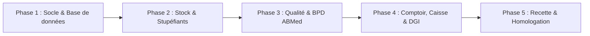

# PLAN D'IMPLÉMENTATION OPÉRATIONNEL — BESTPHARMA

**Référence :** Cahier des Charges BEGPHARMA (`CDC-BEGPHARMA.zip`, Version 1.0)  
**Branche :** `feat/recommandations-modifications`  
**Date :** 13 Novembre 2026

---

## 1. VISION ET OBJECTIFS DE LIVRAISON

L'objectif de ce plan est de transformer les acquis récents du projet en une **version de production certifiable ABMed et DGI**, en liquidant les 191 anomalies relevées dans le CDC d'origine et en respectant les 44 règles globales (**RG-01 à RG-44**).

---

## 2. DÉCOUPAGE PAR PHASES ET JALONS

### Phase 1 — Socle Base de données, Migrations & Intégrité
> **Objectif :** Garantir que PostgreSQL exécute 100 % des tables réelles sans rupture ni tables manquantes.

* [x] **Tâche 1.1 — Exécution des migrations unifiées**
  * Migrer `comptabilite_syscohada`, `paie`, `fiscalite_connectors`, `remaining_cdc`.
  * Commande exécutée : `cd backend && php artisan migrate`.
* [x] **Tâche 1.2 — Vérification des contraintes d'intégrité append-only (RG-31, RG-38)**
  * Triggers d'inaltérabilité appliqués sur `compta_ecritures`, `cdc_stupefiants_entries`, `cdc_preparations` (`2026_11_13_000001_create_inalterability_triggers.php`).
  * Modèle Eloquent `ComptaEcriture` verrouillé contre tout `UPDATE` ou `DELETE` dès validation.
* [x] **Tâche 1.3 — Seeding des comptes et modèles types**
  * 59 modèles types BPD créés dans `cdc_bpd_templates`.
  * Plan SYSCOHADA initialisé (13 comptes par défaut, 5 journaux officinaux, apport initial).
  * 14 modules officinaux activés dans `officine_modules`.
  * Tests automatisés de validation : `tests/Feature/InalterabilityAndSeederTest.php` (3/3 passés).

---

### Phase 2 — Magasin, Stock FEFO & Stupéfiants Tableau B
> **Objectif :** Assurer la traçabilité sanitaire de bout en bout et zéro repli silencieux.

* [ ] **Tâche 2.1 — Traçabilité FEFO stricte (Art. 5.2 BPD / RG-29)**
  * Verrouillage du tri FEFO par date d'expiration pour la délivrance comptoir.
  * Déclenchement automatique de la quarantaine avec blocage de vente lors d'un avis de rappel (STO-14).
* [ ] **Tâche 2.2 — Registre des Stupéfiants Tableau B (STU-01 à STU-22)**
  * Suppression de tout `.catch(() => null)` pouvant masquer un écart de balance.
  * Émission des PV de destruction avec double signature dont celle du titulaire.
* [ ] **Tâche 2.3 — Préparations Magistrales & Ordonnancier (PRE-01 à PRE-18)**
  * Décompte automatique des matières premières décrémentées du stock FEFO.
  * Fiche de libération pharmaceutique signée avant mise à disposition.

---

### Phase 3 — Qualité Officinale, BPD ABMed & Présence Art. 1.11
> **Objectif :** Obtenir le jalon d'homologation ABMed où aucun document ne déclare de fait inexistant (RG-35).

* [ ] **Tâche 3.1 — Relevés de Température et Chaîne du froid (TEM-01 à TEM-18)**
  * Centralisation des plages 2-8°C et 15-25°C dans une table unique `zones_temperature`.
  * Alerte immédiate et proposition de mise en quarantaine des lots en cas d'excursion.
* [ ] **Tâche 3.2 — Grille d'auto-évaluation des 267 articles BPD**
  * Calcul dynamique du score de conformité par chapitre et global.
  * Passerelle directe vers une action corrective (CAPA) pour tout point non conforme.
* [ ] **Tâche 3.3 — Pointage et Présence physique continue (Art. 1.11 BPD / RG-21)**
  * Scan de badge avec vérification serveur stricte (zéro repli sur un employé par défaut).
  * Application du mode `blocage` : interdiction de valider une dispensation si aucun pharmacien n'est pointé présent.
* [ ] **Tâche 3.4 — Élimination des documents déclaratifs fictifs (RG-35)**
  * Remplacement des faux certificats d'étalonnage et trames de rapport par des états basés sur les données réelles enregistrées.

---

### Phase 4 — Comptoir, Caisse, e-MECEF DGI & Paiements
> **Objectif :** Activer les flux financiers en partie double et la facturation normalisée béninoise.

* [ ] **Tâche 4.1 — Sessions de Caisse POS Tactile (CAI-01 à CAI-08)**
  * Interdiction d'émettre un ticket sans session de caisse explicitement ouverte par l'opérateur.
  * Clôture avec calcul contradictoire du montant attendu vs déclaré et saisie de l'écart.
* [ ] **Tâche 4.2 — Activation du connecteur e-MECEF DGI (FDG-01 à FDG-16)**
  * Renseignement des clés de production : `MECEF_TOKEN`, `MECEF_IFU`, `MECEF_API_URL`.
  * Certification réelle des factures de vente (`FV`) et d'avoir (`FA`) avec restitution du QR code et du compteur.
* [ ] **Tâche 4.3 — Activation du connecteur FeexPay (Mobile Money & Carte)**
  * Renseignement de `FEEXPAY_SHOP_ID`, `FEEXPAY_API_KEY`, `BILLING_WEBHOOK_SECRET`.
  * Validation du cycle de paiement Mobile Money MTN / Moov / Celtiis avec accusé de réception webhook.
* [ ] **Tâche 4.4 — Synchronisation comptable SYSCOHADA**
  * Génération automatique des écritures de vente (7011 / 4431 / 5311) et de caisse à chaque clôture.

---

### Phase 5 — Recette Automatisée, Tests E2E & Mise en Production
> **Objectif :** Valider l'ensemble des critères d'acceptation de l'annexe D.

* [ ] **Tâche 5.1 — Exécution de la suite de recette `recette-grep.sh`**
  * Contrôle des 14 points critiques de l'annexe D (codes de secours, secrets, faux documents, replis).
* [ ] **Tâche 5.2 — Tests de non-régression Backend & Frontend**
  * Backend : validation PHPUnit (`SecurityAuditRegressionTest`, `Module16`, `Module17`, `Module18`, etc.).
  * Frontend : validation Vitest (167 tests existants) et validation du build `vite build`.
* [ ] **Tâche 5.3 — Fusion et Déploiement**
  * Revue de code, fusion de la branche `feat/recommandations-modifications` sur `main`.
  * Tag de version release `v1.0.0-abmed`.

---

## 3. TABLEAU RÉCAPITULATIF DES LOTS ET LIVRABLES

| Phase | Livrable Principal | Critère d'Acceptation |
| :--- | :--- | :--- |
| **Phase 1** | Tables PostgreSQL et schéma scellé | `php artisan migrate` sans erreur, triggers append-only actifs |
| **Phase 2** | Gestion des stocks FEFO & Stupéfiants | Rejets des ventes périmées, balance des stupéfiants sans repli |
| **Phase 3** | Espace Qualité BPD & Présence Art. 1.11 | Blocage caisse en absence de pharmacien, score 267 arts dynamique |
| **Phase 4** | e-MECEF & FeexPay configurés | Récupération du `codeMECeFDGI`, validation webhook de paiement |
| **Phase 5** | Recette globale et certification | Sortie 14/14 du script de recette, build production vert |
